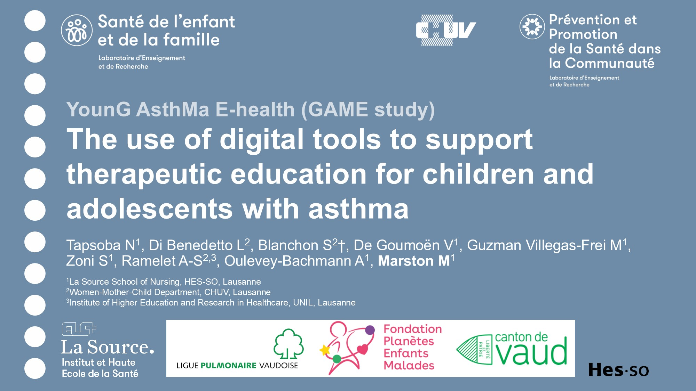

Background. Asthma is the most common chronic disease in childhood, affecting around one child in ten, and places a substantial burden on children, their families and the healthcare system. Therapeutic patient education (TPE) supports self-management and symptom control, and digital tools can make it more accessible, engaging and continuous. However, existing tools are rarely adapted to the age of their users, can leave families feeling a loss of autonomy, and no evidence-based, child- and family-centred digital TPE tool exists in French-speaking Switzerland.
Aim. The GAME project aims to identifiy key components of a digital tool supporting TPE for children and adolescents aged 7 to 17 with asthma and their families.

Methods, results, discussion and conclusions. *In preparation.*


Not published on the website until the results are published. Remove the comment and endcomment lines (and the "In preparation" line above) to show this text.

Methods and results. We conducted a sequential mixed-methods study, approved by the local ethics committee (CER-2024-02570). Child-parent duos were recruited by convenience sampling and HCPs by purposive sampling. In the quantitative phase, each participant completed a Q-sort for each of the four groups of characteristics, ranking cards that described each item on a forced distribution from least to most important. The sorts were analysed with Q-methodology, a form of factor analysis, to describe the importance attributed to each item, the level of consensus and how often it was chosen. In the qualitative phase, separate focus group interviews were held with child-parent duos and with HCPs and analysed thematically; both strands were merged at the interpretation stage. Thirty-six participants (9 HCPs, 14 parents and 13 children, 7 aged 7 to 10 and 6 aged 11 to 17) completed all Q-sorts, and 27 took part in the interviews; children aged 7 to 10 did not take part in interviews for cognitive and organisational reasons. Three factors explained more than 50% of the variance. Preliminary results show strong agreement on education and self-management, a diary of symptoms, crises and history, and decision support as core components; an application as the main instrument, with gamification or serious games and regular, attended updates; and simple, visual and accessible interactions (offline use, audio, data sharing) with notifications. Expected outcomes were self-management, adherence, symptom and treatment control, fewer crises, knowledge and quality of life. Views diverged on emergency help, the level of detail of the history, notification frequency, AI assistance and peer-to-peer exchange, and children valued serious games more than parents and HCPs did. Integration of both strands describes an ideal tool made of several modules that is accessible (offline, multilingual, simple interface), flexible (adapted to the user and their age, modular) and reliable (scientific, HCP-related content and feedback).
Discussion. A major strength of the study is the involvement of the main future users, with strong convergence between parents and HCPs on the fundamentals of TPE. Risks to address include digital overload, inadequate gamification and dependency, and ethical concerns around data protection, confidentiality and transparency.
Conclusions. There is no one-size-fits-all digital solution, but shared, evidence-based core characteristics of digital TPE clearly emerged. A well-designed TPE app is a promising lever to improve paediatric asthma care, provided it offers a structured and reliable instrument that fits into families' day-to-day lives.


### Funding

This project was made possible thanks to funding from the <a href="https://fpem.ch/" target="_blank" rel="noopener">Fondation Planètes Enfants Malades</a>, the <a href="https://lpvd.ch/" target="_blank" rel="noopener">Ligue Pulmonaire Vaudoise</a> and the <a href="https://www.vd.ch/sante-soins-et-handicap/prevention-et-maladies/appel-a-projets" target="_blank" rel="noopener">Canton de Vaud</a> (Commission de Promotion de la Santé et de Lutte contre les Addictions).

  
  
  
  
  

